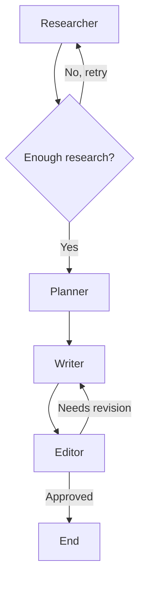

# Graph + State Management Flow in Blog Agent

Yeh file aapko explain karta hai ki is project mein LangGraph ka graph kaise kaam karta hai aur state management kaise current run ko monitor aur control karta hai.

---

## 1. Main idea
Is project mein hum ek “state machine” bana rahe hain:

- Har step ek node (researcher / planner / writer / editor) ko execute karta hai.
- Har node current state ko read karta hai.
- Har node apni output ko partial update ke form mein return karta hai.
- LangGraph in partial updates ko existing state ke saath merge karta hai.
- Phir routing function decide karta hai ki next step kya ho.

Isliye yahan “monitoring” ka matlab hai ki har step ke baad hum current state ko inspect kar sakte hain.

---

## 2. Where the graph is defined
Graph ka main definition [src/graph.py](src/graph.py) mein hai.

Yahan hum:

- `StateGraph(BlogState)` create karte hain
- nodes add karte hain: `researcher`, `planner`, `writer`, `editor`
- entry point set karte hain: `researcher`
- conditional edges define karte hain jahan routing hoti hai

### Important pieces in [src/graph.py](src/graph.py)

- `route_after_research` → decide karta hai ki research complete ho gaya ya phir researcher dobara chalega
- `route_after_planner` → check karta hai ki outline ban gaya ya nahi
- `route_after_writer` → check karta hai ki draft ready hai ya nahi
- `route_after_editor` → decide karta hai ki draft approve hua ya writer ko dubara revise karna hai

---

## 3. What is the state
State ka schema [src/state.py](src/state.py) mein define kiya gaya hai.

Yeh `BlogState` ek Pydantic model hai jismein sabhi run-time data store hota hai.

### Key fields

- `topic`, `audience`, `tone` → user input
- `research_results` → researcher ke search results
- `research_iterations` → kitni baar research hua
- `outline` → planner ka structured output
- `draft` → writer ka generated blog draft
- `edit_feedback` → editor ke review comments
- `revision_count` → kitni baar revise hua
- `current_agent` → current node ka naam
- `error` → agar koi issue aayi to
- `final_blog` → final approved blog content

### Why state is important
State ka use isliye hota hai kyunki:

- agents direct ek dusre ko call nahi karte
- har agent ko apni previous work ka context milta hai
- monitoring easy hoti hai
- replay/debugging easy ho jati hai

---

## 4. Start of the workflow
Workflow start hota hai [src/main.py](src/main.py) mein.

### Step-by-step

1. Initial state banaya jata hai:
   - topic
   - audience
   - tone
   - session_id

2. `blog_graph.stream(...)` chalaaya jata hai.

3. `initial_state.model_dump()` se state ko dict form mein graph ko diya jata hai.

4. Graph har node ke baad state ko update karta rehta hai.

### Important line in [src/main.py](src/main.py)

```python
for step in blog_graph.stream(initial_state.model_dump(), config=config):
```

Yahan `stream()` har node execution ke baad output emit karta hai. Isse aap current progress monitor kar sakte ho.

---

## 5. How a node works
Har node apna kaam karta hai aur apni chhoti si update return karta hai.

### Example: Researcher node
See [src/agents/researcher.py](src/agents/researcher.py)

Researcher:

- web search karta hai
- results collect karta hai
- ek `ResearchResult` object banata hai
- state ko update karta hai:
  - `research_results`
  - `research_iterations`
  - `current_agent`

### Important idea
Researcher directly state mein update karta hai, aur graph usko next step ke liye use karta hai.

---

## 6. How the graph moves from one node to another
Graph ka control flow [src/graph.py](src/graph.py) mein define hai.

### Flow in simple words



### Routing logic

- Researcher ke baad `route_after_research` decide karta hai
- Planner ke baad `route_after_planner` decide karta hai
- Writer ke baad `route_after_writer` decide karta hai
- Editor ke baad `route_after_editor` decide karta hai

### Circuit breakers
Yeh project production-safe design follow karta hai:

- `max_research_iterations` → research loop ko limit karta hai
- `max_revision_cycles` → writer-editor loop ko limit karta hai

Isse infinite looping se bachte hain.

---

## 7. How state flows through each phase

### Phase 1: Research
In [src/agents/researcher.py](src/agents/researcher.py)

- search results collect hote hain
- ek research result object create hota hai
- `research_results` list mein append hota hai
- `current_agent` set hota hai: `planner` ya `researcher`

### Phase 2: Planning
In [src/agents/planner.py](src/agents/planner.py)

- research findings ko summarize kiya jata hai
- outline generate hoti hai
- `outline` field fill hoti hai
- `current_agent` set hota hai: `writer`

### Phase 3: Writing
In [src/agents/writer.py](src/agents/writer.py)

- outline ke hisaab se blog sections generate hote hain
- ek complete draft build hota hai
- `draft` state mein store hota hai
- `current_agent` set hota hai: `editor`

### Phase 4: Editing
In [src/agents/editor.py](src/agents/editor.py)

- draft review hota hai
- feedback generate hota hai
- agar approve hua to `final_blog` set hota hai
- agar revise chahiye to `revision_count` badhta hai aur writer ko phir bheja jata hai

---

## 8. Why partial updates matter
Har node sirf woh fields return karta hai jo usne change kiye hain.

Example:

- Researcher returns research-related fields
- Writer returns draft-related fields
- Editor returns feedback/final_blog fields

Isse yeh benefit milta hai:

- state predictable rehta hai
- agents ke beech accidental overwrite kam hota hai
- debugging aur observability better hoti hai

---

## 9. How monitoring works
Monitoring ka kaam basically yeh hai ki aap state ke har change ko dekh sakte ho.

In [src/main.py](src/main.py), after every node execution, the code prints:

- current node name
- research result count
- outline title
- draft version/word count
- approval or revision status

Isse aapko lagta hai jaise “real-time lifecycle” dikh rahi ho.

### In simple terms
Aap graph ko ek pipeline samjho:

1. initial state
2. researcher adds research data
3. planner creates structure
4. writer creates draft
5. editor approves/revises
6. final output generated

Aur har step pe state update ho raha hota hai.

---

## 10. One-line summary
Is project mein graph ka kaam state ko step-by-step advance karne ka hai, aur state management ka kaam hai ki har agent ko current context milta rahe aur execution deterministic aur observable rahe.

Agar aap chaho, main isi file ko aur bhi “interview-ready” style mein likh sakta hoon — jismein “LangGraph flow”, “state machine”, aur “why this design is production-friendly” ko aur zyada crisp way mein explain kiya jaaye.
