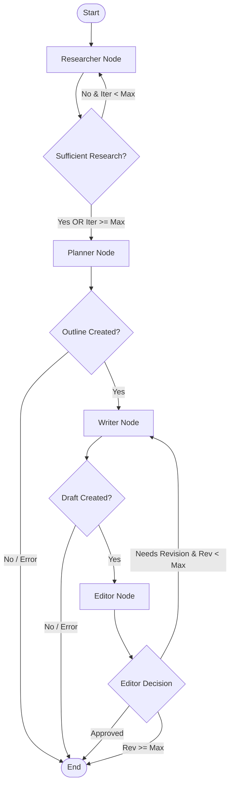

# 🧠 Blog Agent — Deep-Dive Interview Preparation Guide

This guide is designed for **GenAI Engineer / Agentic AI Engineer** interviews. It breaks down every component, architectural decision, technology trade-off, and failure recovery strategy used in this project.

---

## 1. Project Pitch & Overview

### 30-Second Elevator Pitch
> "Blog Agent is a production-grade multi-agent autonomous system built with **LangGraph**, **LangChain**, **Groq**, and **Tavily**. Given a topic, target audience, and tone, it coordinates four specialized agents—Researcher, Planner, Writer, and Editor—through a stateful graph. It handles real-time web research, structured outline generation, section-by-section drafting, and an iterative critique loop with circuit breakers to prevent infinite loops. It also includes an event-driven HTTP server supporting real-time human-in-the-loop (HITL) checkpoints and full LangSmith/Langfuse observability."

### Key Metrics
- **Agents**: 4 specialized nodes (`Researcher`, `Planner`, `Writer`, `Editor`)
- **Execution Latency**: ~60–80 seconds total
- **LLM Calls**: ~18 calls per complete cycle (1 research eval, 1 outline, 7 writer sections × 2 drafts, 2 editor reviews)
- **Token Efficiency**: ~22,000 tokens total per run (achieved via strict context window compression & max-character caps)
- **Observability**: Dual-tracing with LangSmith & Langfuse

---

## 2. System Architecture & Component Design

### Graph Topology & Flow

### Core Design Principle: Shared State Communication
Agents **never call each other directly**. Communication happens purely through a shared, immutable Pydantic schema (`BlogState`).
- Nodes read `BlogState`.
- Nodes perform LLM/Tool execution.
- Nodes return **partial state updates** (dictionaries).
- LangGraph merges updates into `BlogState`.
- Pure-Python **routing functions** evaluate `BlogState` to select the next node.

### State Management: How `BlogState` Works
The project uses a single canonical `BlogState` object to carry all run data through the graph.
- `BlogState` is defined as a Pydantic model with typed fields for `topic`, `research_findings`, `outline`, `draft`, `editor_feedback`, `status`, `error`, and counters like `research_iteration` and `revision_cycle`.
- Each node receives the current state snapshot and returns only the fields it changes.
- LangGraph takes those partial updates and merges them into the existing `BlogState`, producing a new immutable state for the next step.
- This means the graph is effectively a state machine: agents transform state, routing functions inspect the updated state, and the next node is chosen deterministically.
- Because updates are partial and validated, the system avoids cross-agent side effects and makes it easy to debug or replay runs.

---

## 3. Technology Stack & Trade-Off Analysis

| Technology | Role | Why Selected | Why Alternatives Were Rejected |
|---|---|---|---|
| **LangGraph** | Agent Orchestration & State Machine | Cyclical graph support, explicit state schemas, deterministic routing | **AutoGen**: Too conversational/unpredictable for structured tasks. **CrewAI**: Too opinionated, hides graph topology. |
| **Groq (Llama 3.3 70B & 3.1 8B)** | LLM Inference | ~500+ tokens/sec throughput, zero-latency feedback loop | **OpenAI GPT-4o**: Higher cost and latency for multi-step agent loops. |
| **Tavily API** | Web Search Tool | Pre-filtered, AI-ready search snippets and clean URL metadata | **SerpAPI / Google Search**: Returns raw HTML/links requiring custom scraping & extraction logic. |
| **Pydantic v2** | State Schema & Contracts | Runtime validation, type safety, seamless JSON serialization | **Raw Python Dicts**: Prone to key errors and silent data corruption across agent boundaries. |
| **LangSmith & Langfuse** | Observability & Tracing | Deep prompt tracing, execution latency tracking, session metadata filtering | **Custom Logging**: Hard to visualize multi-turn agent handoffs and token consumption. |
| **Python stdlib `http.server` & SSE** | Web UI & Streaming | Zero frontend build tools, native Server-Sent Events (SSE) for live timeline updates | **FastAPI + WebSockets**: WebSockets are bidirectional overkill; SSE is lightweight for 1-way event push. |

---

## 4. Agent Deep-Dives

### 1. Researcher Agent (`src/agents/researcher.py`)
- **Role**: Discovers up-to-date domain data via Tavily.
- **Iteration-based Queries**: Uses different prompt templates per iteration (`{topic} tutorial guide`, `{topic} best practices architecture`, `{topic} real world case studies`) to guarantee query diversity.
- **Model Routing**: Uses `llama-3.1-8b-instant` (fast, cheap) to evaluate if findings are sufficient to write a full post.
- **Deterministic Fallback**: If LLM evaluation fails or stalls after 2 iterations with $\ge 4$ findings, a heuristic rule forces `sufficient = True`.

### 2. Planner Agent (`src/agents/planner.py`)
- **Role**: Transforms raw search findings into a structured blog outline.
- **Context Window Protection**: Deduplicates findings, trims each to 150 characters, and caps input at 8 items. This prevents context explosion.
- **Output Validation**: Employs `JsonOutputParser` with `llama-3.3-70b-versatile` to produce a `BlogOutline` object containing title, sections, target audience, and word count estimate.

### 3. Writer Agent (`src/agents/writer.py`)
- **Role**: Drafts the complete blog post section by section.
- **Section-by-Section Sequential Generation**: Rather than writing 3,000 words in one call (which leads to quality degradation), it iterates over `outline.sections`.
- **Context Carryover**: Passes only the last 800 characters of the preceding section to maintain smooth narrative transitions while avoiding context blowup.
- **Revision Handling**: On revision passes, incorporates structured feedback from the Editor into every section prompt.

### 4. Editor Agent (`src/agents/editor.py`)
- **Role**: Critically evaluates the draft against 5 dimensions: Accuracy, Completeness, Clarity, Flow, and Practicality.
- **Capped Input**: Evaluates draft quality using `draft.content[:3000]` characters to keep review calls fast and token-efficient.
- **Approval Rule**: Approves (`approved: True`) only if quality score $\ge 7/10$. Otherwise returns structured lists of specific `issues` and actionable `suggestions`.
- **Fail-Open Safety**: If the Editor node crashes or encounters a parsing error, it defaults to approving the draft (`final_blog = state.draft.content`) so work is never lost.

---

## 5. Production Guardrails & Circuit Breakers

In production agentic systems, non-deterministic LLMs can get stuck in infinite execution loops. The system enforces strict circuit breakers:

1. **Max Research Iterations (`max_research_iterations = 3`)**: Prevents the Researcher from querying Tavily infinitely if findings are sparse.
2. **Max Revision Cycles (`max_revision_cycles = 2`)**: Prevents infinite ping-pong between Writer and Editor if the Editor's standards are too high.
3. **Context Capping**:
   - Researcher findings trimmed to 150 chars for Planner.
   - Writer context capped to last 800 chars of prior section.
   - Editor review capped to first 3,000 chars of draft.
4. **Deterministic Control Flow**: Routing functions (`route_after_research`, `route_after_planner`, `route_after_writer`, `route_after_editor`) are **pure Python code**, not LLM decisions.

---

## 6. Human-in-the-Loop (HITL) Architecture

The project supports interactive human oversight via a custom event-driven UI (`src/frontend.py` + `static/`):
- **Threading Condition Locks**: Execution runs on a background worker thread (`_run_worker`). At each checkpoint, `session.status` becomes `"waiting"`, and the thread waits on `session.condition.wait()`.
- **REST Control Endpoint**: When a user clicks a button (Continue, More Research, Revise, Accept Final) in the web UI, `/api/runs/<id>/control` updates `session.state` and calls `session.condition.notify_all()`, resuming the worker thread.
- **SSE Timeline**: Real-time events (`agent_started`, `agent_finished`, `checkpoint`, `human`, `completed`) are streamed to `app.js` using Server-Sent Events (`/api/runs/<id>/events`).

---

## 7. High-Frequency Interview Q&A

### Q1: Why did you choose LangGraph over CrewAI or AutoGen?
> **Answer**: LangGraph provides explicit, graph-based control over agent state and execution edges. In CrewAI or AutoGen, agent interactions are often autonomous conversational loops, which can lead to unpredictable execution paths, unexpected token consumption, and difficulty enforcing strict circuit breakers. With LangGraph, we define a typed Pydantic state and pure-Python routing functions, giving us deterministic control over state transitions while letting LLMs focus on task execution inside the nodes.

### Q2: How do you handle context window limits and token costs in multi-agent workflows?
> **Answer**: We use three strategies:
> 1. **Model Routing**: We use lightweight models (`llama-3.1-8b`) for simple tasks like research evaluation, and heavy models (`llama-3.3-70b`) only for reasoning, planning, and drafting.
> 2. **Context Compression**: In the Planner, findings are deduplicated and trimmed to 150 characters. In the Writer, only the last 800 characters of the preceding section are passed for continuity.
> 3. **Sectional Generation**: We draft section-by-section rather than asking for 3,000 words in a single completion.

### Q3: What happens if an agent fails or produces invalid JSON?
> **Answer**: 
> - **Planner/Editor**: We use `JsonOutputParser`. If parsing fails, exceptions are caught, recorded in `state.error`, and routed safely.
> - **Editor Fail-Open**: If the Editor node encounters an unrecoverable error during critique, it fails open by approving the current draft (`final_blog = draft.content`), ensuring generated text is never lost.
> - **Researcher Fallback**: If LLM evaluation fails, a heuristic rule evaluates findings count and iteration count to decide whether to proceed.

### Q4: How is Human-in-the-Loop implemented without blocking the web server?
> **Answer**: Each run is managed in a separate Python daemon thread (`_run_worker`) with a `threading.Condition` lock. The main thread runs a non-blocking `ThreadingHTTPServer`. When an agent reaches a checkpoint, the worker thread pauses using `condition.wait()`. The user interacts with the UI, posting to `/api/runs/<id>/control`, which mutates the state and invokes `condition.notify_all()` to unblock the worker thread.

---

## 8. Summary Checklist for Interview Readiness

- [x] Can explain the graph topology (`Researcher` $\rightarrow$ `Planner` $\rightarrow$ `Writer` $\leftrightarrow$ `Editor`).
- [x] Can articulate why agents communicate via state updates rather than direct calls.
- [x] Can defend model choices (`llama-3.1-8b` for evaluation vs `llama-3.3-70b` for generation).
- [x] Can explain circuit breakers (`max_research_iterations`, `max_revision_cycles`).
- [x] Can explain how SSE streams live progress to the frontend.
- [x] Can discuss cost optimization techniques (context trimming, sliding window context).
