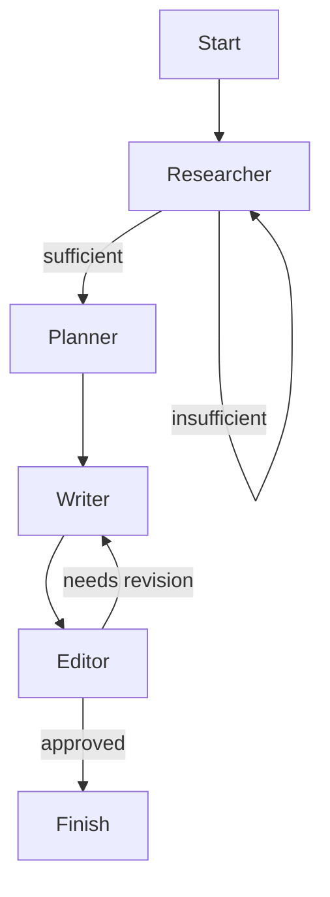

# Blog Agent

A small multi-agent blog writing prototype built with LangGraph, LangChain-style prompts, and Tavily web search.

## What this project does

- Starts with a topic and audience
- Runs a state graph across 4 agents:
  - `researcher` collects web search findings
  - `planner` creates a structured blog outline
  - `writer` drafts the blog one section at a time
  - `editor` reviews and either approves or requests revisions
- Final output is written to `output_draft.md`

## Architecture

The project is organized as a state-driven pipeline rather than a linear script.

- `src/main.py` initializes the process and prints progress
- `src/graph.py` defines the graph transitions and the allowed workflow
- `src/state.py` defines the shared typed state model used by every agent
- `src/llm.py` configures the primary and fast LLM clients
- `src/agents/*.py` contains the agent implementations

### Agent flow



### Core state model

- `BlogState` holds the workflow inputs, research results, outline, draft, editor feedback, revision counts, and completion signals.
- Each node returns state updates rather than mutating global state directly.

## Key files

- `src/main.py` — entry point
- `src/graph.py` — state graph and routing logic
- `src/state.py` — data schemas and shared state
- `src/llm.py` — configured LLM clients
- `src/agents/researcher.py` — web search + sufficiency judgment
- `src/agents/planner.py` — outline generation
- `src/agents/writer.py` — section-by-section draft generation
- `src/agents/editor.py` — review and revision loop
- `test_setup.py` — quick manual smoke test for Groq + Tavily

## Running locally

1. Create a `.env` file with required credentials.
2. Activate the virtual environment.
3. Run:

```bash
python src/main.py
```

> Note: The current repo does not include a `requirements.txt` or `pyproject.toml`, so dependency installation is not documented in repo files.

## Running the web UI

The repo also includes a dependency-free local dashboard for monitoring and steering a run:

```bash
python src/frontend.py
```

Open `http://127.0.0.1:8000`.

If port `8000` is already busy, the server automatically uses the next free port and prints the exact URL in the terminal.

The UI lets you:

- Start a blog run with topic, audience, tone, and loop limits
- Watch researcher, planner, writer, and editor events stream live
- Pause at each agent checkpoint before continuing
- Request more research from the researcher
- Edit the planner outline JSON before writing begins
- Send human revision notes back to the writer
- Accept a draft as final and save it under `outputs/<run-id>.md`

## Production readiness review

### What is strong

- Clear multi-agent architecture with a state graph
- Typed schemas using `pydantic` for shared state
- Guardrails on research iterations and revision loops
- Separate fast evaluator model (`llm_fast`) for judgments
- Fail-open editor path so a draft is preserved if review fails

### What is not production grade yet

- No dependency manifest (`requirements.txt` or `pyproject.toml`)
- No formal packaging, startup script, or CLI options
- No structured logging, monitoring, or metrics
- No retry/fallback layer for LLM providers or API keys
- No unit or integration tests for workflow correctness
- No explicit prompt/result validation outside basic JSON parsing
- No security/process for secret/config management beyond `.env`
- `static/` and `src/frontend.py` are placeholders with no UI implementation
- Hardcoded model configuration in `src/llm.py`
- No observability for cost, latency, or failure modes

## Recommended improvements

### 1. Fallback LLMs and API keys

- Add a provider abstraction layer for LLM calls
- Support multiple models/providers in priority order
- On failure, retry with alternate API key or provider
- Add backoff and circuit breaker behavior for provider errors
- Store keys securely and rotate them if limits are hit

### 2. Stronger config and packaging

- Add `requirements.txt` or `pyproject.toml`
- Add structured config via `pydantic.BaseSettings`
- Avoid hardcoding model names and timeouts in code
- Add CLI flags for topic, audience, output path

### 3. Logging and observability

- Replace `print()` with Python `logging`
- Emit structured events for each agent step
- Capture success/failure, request/response times, and costs
- Add metrics for revision cycles, prompt failures, and API retries

### 4. Output validation and safety

- Validate every LLM response against expected schema
- Add sanity checks for outline length, draft size, and JSON parseability
- Add content safety / hallucination detection for production use

### 5. Tests and CI

- Add unit tests for `state.py`, routing functions, and prompt formatting
- Add integration tests that simulate the graph with mocked LLM responses
- Add CI workflow for linting and test execution

### 6. UI or service layer

- If web UI is needed, implement `src/frontend.py` or a simple FastAPI/Flask service
- Add request/response handling and end-to-end UI flow
- Add persistence for drafts and research history if required

## Suggested next steps

1. Add dependency manifest and install instructions.
2. Build an LLM wrapper with provider fallback and retries.
3. Add proper config management and remove hardcoded secrets.
4. Introduce logging and observability.
5. Add tests and CI.

## Summary

This repo is a good prototype with a well-structured multi-agent workflow, but it is not yet production ready. The most important improvements are: dependency packaging, provider fallback, observability, input/config validation, and test coverage.
