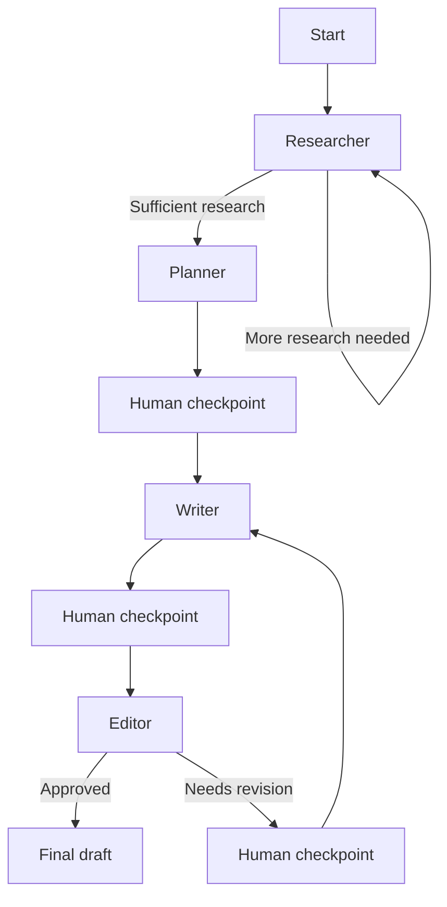

# Blog Agent

Blog Agent is a small multi-agent blog-writing system built with LangGraph, LangChain-style prompts, Groq-hosted chat models, and Tavily web search.

It takes a topic, researches it, plans an outline, writes a draft, reviews the draft, and supports human-in-the-loop checkpoints through a local monitoring UI.

## Features

- Researcher, planner, writer, and editor agents wired through a LangGraph state graph
- Tavily-powered research with sufficiency checks
- Structured Pydantic state shared across agents
- Revision loop with a max-cycle guardrail
- Human-in-the-loop web UI for monitoring and approvals
- Live event timeline for debugging each agent handoff
- Editable outline checkpoint before writing
- Human revision notes that feed back into the writer
- Markdown draft export

## Architecture



The shared `BlogState` object carries the topic, research results, outline, draft, editor feedback, revision count, errors, and final blog content. Agents return state updates instead of mutating global state.

## Project Structure

```text
.
├── architecture.md          # Detailed execution trace and architecture notes
├── requirements.txt         # Python dependencies
├── src/
│   ├── main.py              # Terminal runner
│   ├── frontend.py          # Local web UI server and run controller
│   ├── graph.py             # LangGraph topology and routing
│   ├── state.py             # Pydantic state schemas
│   ├── llm.py               # Groq model configuration
│   └── agents/
│       ├── researcher.py
│       ├── planner.py
│       ├── writer.py
│       └── editor.py
├── static/                  # Browser UI assets
└── test_setup.py            # Manual Groq + Tavily smoke test
```

## Prerequisites

- Python 3.12+
- Groq API key
- Tavily API key

## Setup

Clone the repository and create a virtual environment:

```bash
git clone <your-repo-url>
cd blog-agent
python -m venv venv
source venv/bin/activate
pip install -r requirements.txt
```

Create your local environment file:

```bash
cp .env.example .env
```

Then fill in:

```bash
GROQ_API_KEY=your_groq_api_key_here
TAVILY_API_KEY=your_tavily_api_key_here
```

Optional model overrides:

```bash
GROQ_PRIMARY_MODEL=llama-3.3-70b-versatile
GROQ_FAST_MODEL=llama-3.1-8b-instant
```

## Run The Web UI

```bash
python src/frontend.py
```

Open the URL printed in the terminal, usually:

```text
http://127.0.0.1:8000
```

If port `8000` is busy, the app automatically uses the next free port and prints the correct URL.

The UI lets you:

- Start a new blog run
- Watch live researcher, planner, writer, and editor events
- Pause at agent checkpoints
- Request more research
- Edit the generated outline
- Send human revision notes to the writer
- Accept a draft as final
- Inspect raw state for debugging

Generated UI drafts are saved under `outputs/<run-id>.md`.

## Run From Terminal

```bash
python src/main.py "Building multi-agent systems with LangGraph"
```

Useful options:

```bash
python src/main.py "Your topic" \
  --audience "backend engineers" \
  --tone "technical but approachable" \
  --output output_draft.md
```

## Smoke Test Credentials

To quickly verify Groq and Tavily credentials:

```bash
python test_setup.py
```

This makes real API calls.

## Development Notes

- The frontend intentionally uses Python's standard library HTTP server and plain HTML/CSS/JavaScript, so no Node or frontend build step is required.
- `.env`, virtual environments, bytecode caches, logs, and generated drafts are ignored by Git.
- `architecture.md` contains a deeper dry run of the graph and state transitions.

## Current Limitations

- Runs are held in memory by the local web server, so refreshing is fine but restarting the server clears run history.
- There is no database or authentication layer.
- Cost and token usage are not tracked yet.
- Automated tests for mocked agent runs would be a good next production step.
